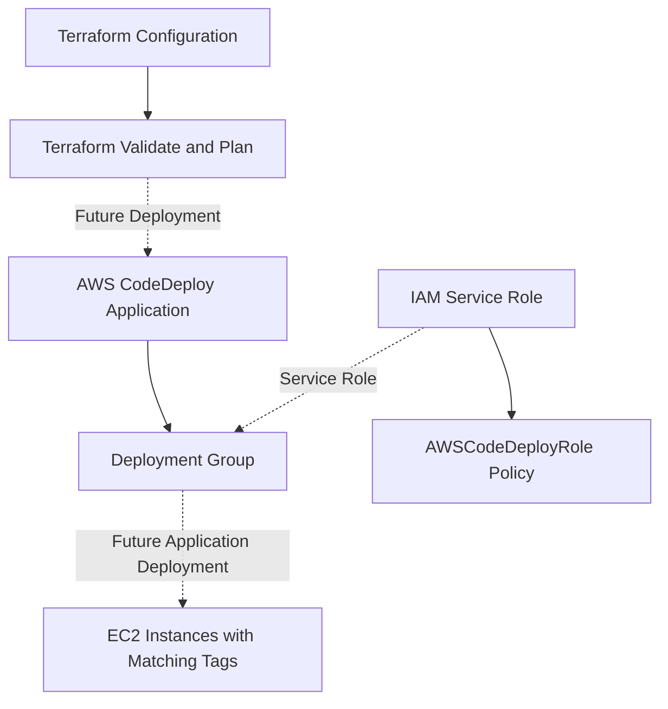

# AWS CodeDeploy Terraform Lab

## Project Overview

This project demonstrates how to use Terraform, AWS CLI, Ubuntu Linux, and Git to plan an AWS CodeDeploy application and deployment group in `us-east-1`.

**Project status: PLAN ONLY — no AWS resources deployed.**

## Architecture



The deployment targets are future possibilities. No EC2 instances were launched or modified by this lab.

## Technologies

- AWS CodeDeploy
- AWS IAM
- AWS CLI
- Terraform 1.17.0
- Ubuntu Linux
- Git and GitHub

## Planned Infrastructure

| Resource | Configuration | Status |
|---|---|---|
| `aws_codedeploy_app.lab` | `terraform-codedeploy-lab` | Planned |
| `aws_iam_role.codedeploy` | `terraform-codedeploy-lab-role` | Planned |
| `aws_iam_role_policy_attachment.codedeploy` | AWS-managed `AWSCodeDeployRole` policy | Planned |
| `aws_codedeploy_deployment_group.lab` | `terraform-codedeploy-lab-group` | Planned |

## Deployment Configuration

- Compute platform: Server
- Deployment strategy: `CodeDeployDefault.OneAtATime`
- EC2 tag key: `CodeDeploy`
- EC2 tag value: `terraform-codedeploy-lab`
- AWS region: `us-east-1`

No matching EC2 instances have been verified.

## AWS Discovery

The AWS CLI returned:

```json
{
  "applications": []
}
```

The CodeDeploy application count was zero.

## Terraform Validation

Commands:

```bash
terraform init
terraform fmt
terraform validate
terraform plan -input=false -no-color
```

Observed results:

```text
Success! The configuration is valid.

Plan: 4 to add, 0 to change, 0 to destroy.
```

## Deployment Status

No `terraform apply` was executed.

No CodeDeploy applications, deployment groups, or IAM roles were created by this lab.

No application deployment was performed.

## Security and Cost

- Terraform state and variable files are excluded from Git.
- No AWS credentials or private keys should be committed.
- The IAM role uses an AWS-managed CodeDeploy service role policy.
- EC2 instances and related services can incur charges.
- The project remains planning-only.

## Future Improvements

- Deploy after explicit authorization.
- Configure a dedicated test EC2 instance.
- Install and validate the CodeDeploy agent.
- Create an application revision and `appspec.yml`.
- Test an application deployment.
- Integrate AWS CodePipeline.

## Validation Evidence

See `docs/validation-evidence.md` and `screenshots/codedeploy-terraform-validation.png`.

